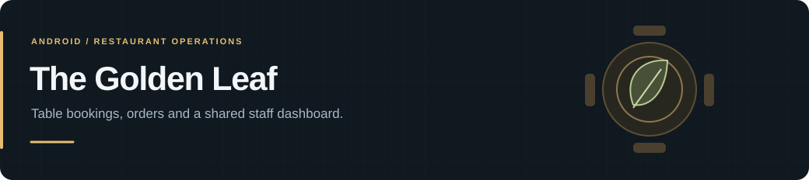
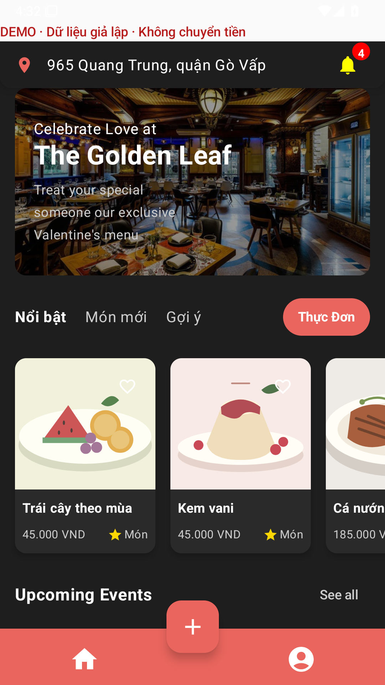
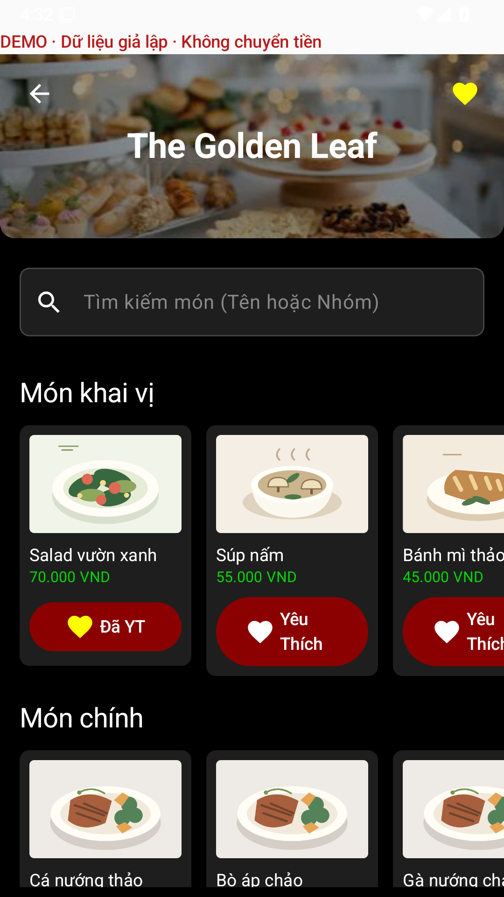
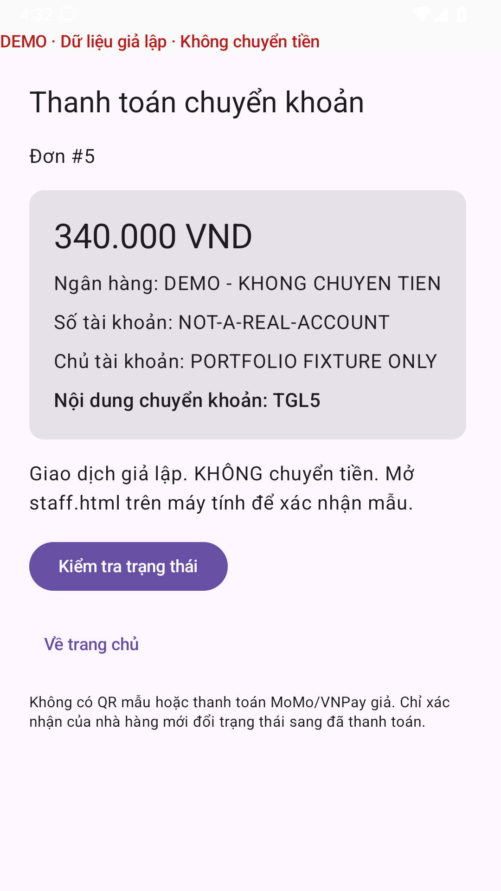
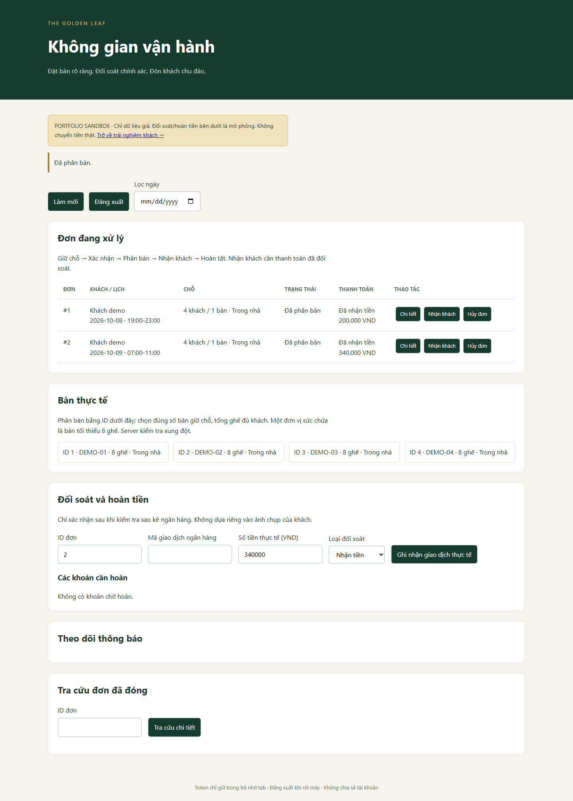
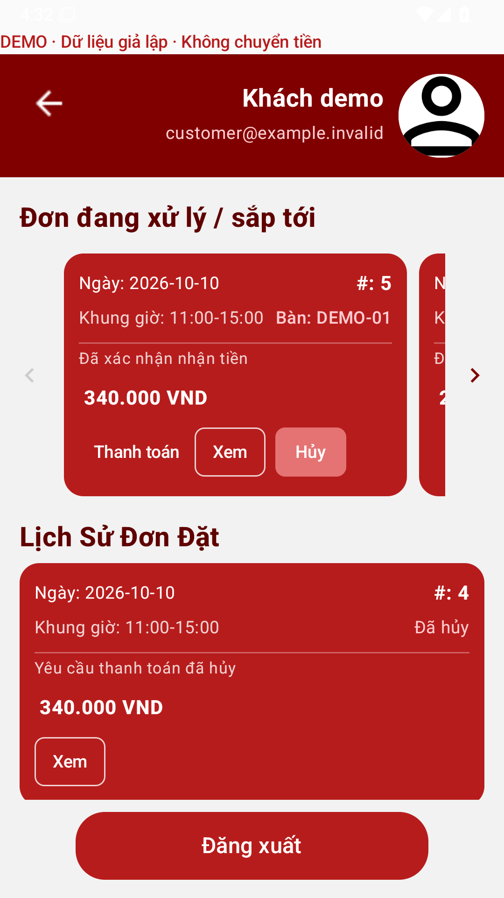
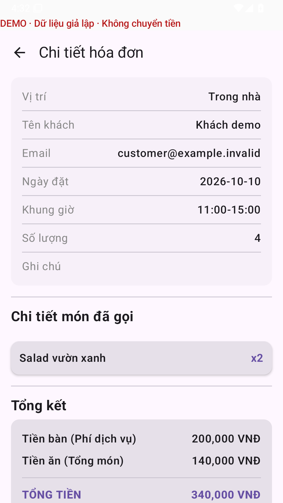
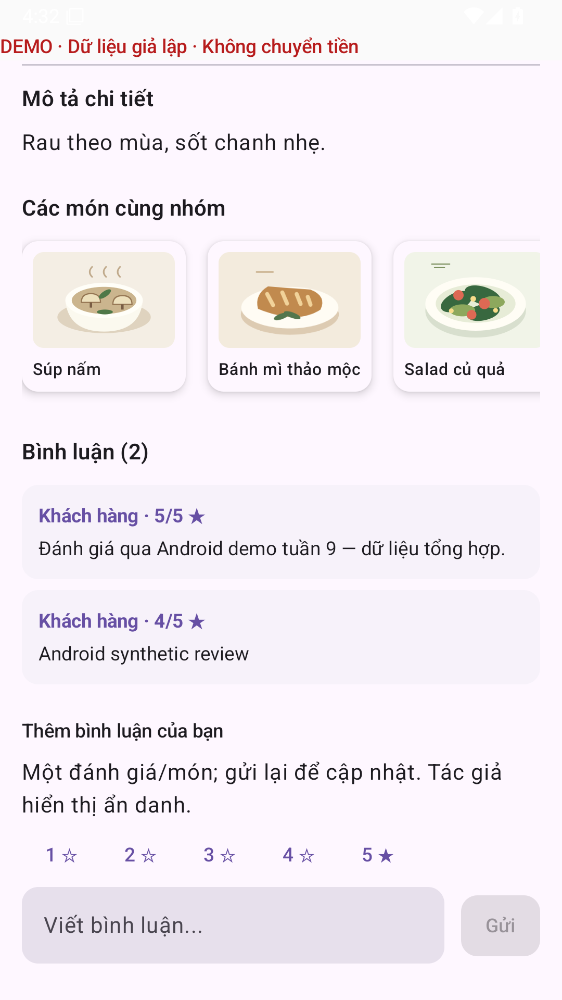

<h1></h1>

Khách đặt bàn, chọn món và theo dõi hóa đơn trên Android. Nhân viên dùng dashboard web để phân bàn, xác nhận chuyển khoản và xử lý đơn. Hai phía dùng chung API Spring Boot.

[](https://github.com/TrinhQuocDat542005/The-Golden-Leaf/actions/workflows/ci.yml)


[Chạy demo](#chạy-demo) · [Tải APK và backend](https://github.com/TrinhQuocDat542005/The-Golden-Leaf/releases/tag/portfolio-v0.10.0) · [API](docs/api-contract.md) · [Hướng dẫn phát triển](docs/DEVELOPMENT.md)

## Giao diện

<p align="center">
  
  
  
</p>

<p align="center"><sub>Ảnh app chạy trên Android Emulator API 35. Dữ liệu và thanh toán trong ảnh là dữ liệu demo.</sub></p>

<details>
<summary>Xem dashboard web, lịch sử đơn và hóa đơn</summary>



<p align="center">
  
  
  
</p>

[Web demo](docs/assets/demo-overview.png) · [Chi tiết đơn](docs/assets/demo-booking.png) · [Giao diện web ở màn hình nhỏ](docs/assets/demo-mobile.png)

</details>

## Chạy demo

Demo dùng H2 in-memory và tài khoản mẫu; cần **JDK 17**, không cần cấu hình Firebase hoặc MySQL. Chỉ chạy local, chưa triển khai cho nhà hàng thực tế hoặc phát hành trên Play Store.

> [!WARNING]
> Bản v0.10.0 còn hai CVE Spring WebMVC chưa vá. Chỉ dùng demo local trước **08/11/2026 00:00 UTC (07:00 giờ Việt Nam)**, không đưa lên Internet hoặc nhập dữ liệu/thanh toán thật. Launcher chặn sau hạn; APK và lệnh Java trực tiếp không có kiểm tra hạn. Xem [SECURITY.md](SECURITY.md).

### Từ mã nguồn

```powershell
git clone https://github.com/TrinhQuocDat542005/The-Golden-Leaf.git
cd The-Golden-Leaf/The-Golden-Leaf-server
./mvnw.cmd spring-boot:run '-Dspring-boot.run.profiles=demo'
```

Linux/macOS dùng `bash mvnw spring-boot:run -Dspring-boot.run.profiles=demo` trong thư mục backend.

Mở [trang khách](http://127.0.0.1:8080/demo.html) hoặc [dashboard nhân viên](http://127.0.0.1:8080/staff.html). Thử chọn ngày mai, đặt bàn, thêm món rồi xác nhận đơn. Nhân viên ghi nhận thanh toán theo dữ liệu giả lập. Restart backend để đặt lại dữ liệu demo.

### Từ bản đóng gói

Tải ZIP và checksum từ [release v0.10.0](https://github.com/TrinhQuocDat542005/The-Golden-Leaf/releases/tag/portfolio-v0.10.0), so SHA-256 rồi giải nén vào thư mục mới:

```powershell
./Verify-Demo.ps1
./Start-Demo.ps1
```

Linux dùng `bash Start-Demo.sh`; script chưa được kiểm thử trên macOS. ZIP có APK, backend JAR và launcher. Xem [hướng dẫn bundle](docs/demo-bundle-guide.md).

**Thử Android:** cài `golden-leaf-demo.apk` trên emulator API 25+ và giữ backend chạy ở cổng **8080**. APK gọi `http://10.0.2.2:8080/`. Khi build từ source, chọn variant **`demo`**; bản debug/release thường vẫn cần Firebase. [Hướng dẫn Android](docs/android-demo.md).

## Những luồng chính

| Khách hàng | Nhân viên và quản trị |
| :--- | :--- |
| Xem thực đơn, lưu món yêu thích, đánh giá món | Quản lý món, ảnh và bàn thực tế |
| Chọn ngày, khung giờ, khu vực và số khách | Lọc đơn, phân bàn, nhận khách và hoàn tất |
| Đặt bàn, thêm món, xem hóa đơn và lịch sử | Đối soát chuyển khoản, xử lý hủy và hoàn tiền |
| Nhận thông báo theo tài khoản | Phân quyền, khóa tài khoản và xem audit |

Server giữ sức chứa và chống đặt trùng trong transaction. Tiền được tính ở backend bằng `BigDecimal`; xác nhận đặt bàn hoặc tạo hóa đơn chưa đồng nghĩa với đã thanh toán. Hệ thống không tự chuyển tiền.

## Công nghệ

| Thành phần | Công nghệ | Mã nguồn |
| :--- | :--- | :--- |
| Android | Kotlin, Jetpack Compose, Hilt, Retrofit | [`app/`](app/) |
| API và dashboard | Java 17, Spring Boot, Spring Security, OpenAPI | [`The-Golden-Leaf-server/`](The-Golden-Leaf-server/) |
| Dữ liệu | MySQL 8, JPA, Flyway; H2 cho test/demo | [Schema](docs/database-schema.md) |
| Xác thực, push | Firebase Authentication và FCM ở bản thường | [Phân quyền và vận hành](docs/weeks-4-5-security-operations.md) |
| Kiểm thử | JUnit, Android unit/instrumentation, Playwright | [Báo cáo v0.10.0](docs/week-10-portfolio-release.md) |

## Kiểm thử

[Lượt CI của v0.10.0](https://github.com/TrinhQuocDat542005/The-Golden-Leaf/actions/runs/37958479705) ghi nhận **191 backend tests, 48 Android unit tests, 3 browser E2E và 14 test cho script**. Emulator API 25/35 chạy 8 test mỗi API. Lint còn 94 warnings và 8 hints, không có errors.

Chưa thử trên điện thoại thật, với Firebase/FCM thật hoặc giao dịch thật. [Lệnh kiểm thử](docs/DEVELOPMENT.md#kiểm-thử) và [báo cáo chi tiết](docs/week-10-portfolio-release.md) phân biệt kết quả tự động với phần cần kiểm chứng tiếp.

## Đọc tiếp

- [Case study và kịch bản demo](docs/week-7-portfolio.md)
- [Luồng đặt bàn và giữ chỗ](docs/week-3-booking-integrity.md)
- [REST API](docs/api-contract.md) · [Database](docs/database-schema.md)
- [Development, biến môi trường và build](docs/DEVELOPMENT.md)
- [Triển khai và backup](docs/week-6-production-readiness.md)
- [Đóng góp](CONTRIBUTING.md) · [Bảo mật](SECURITY.md)
